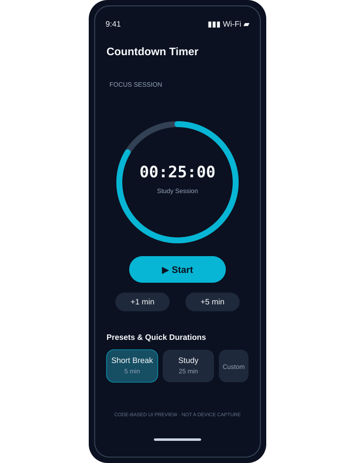
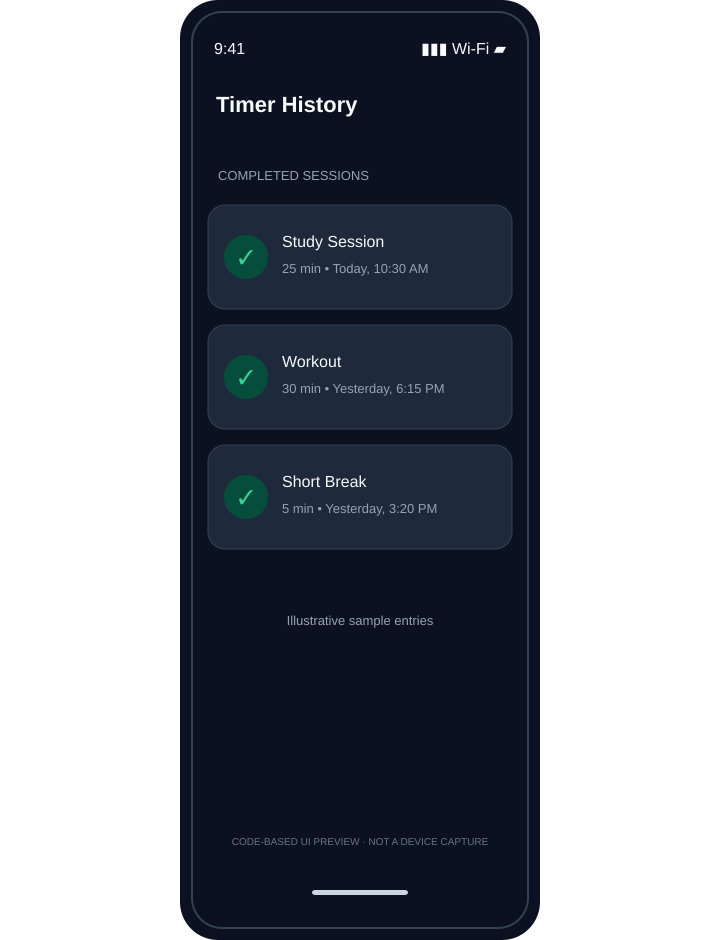
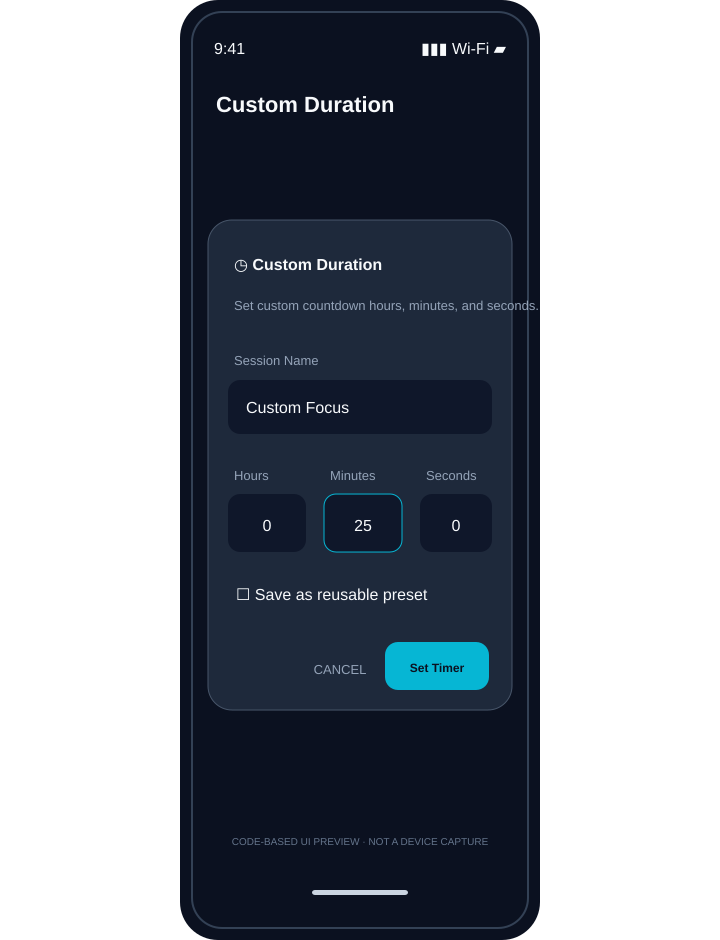
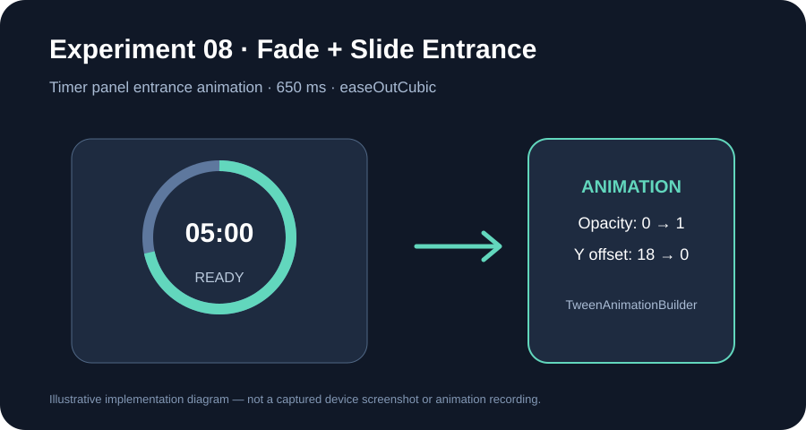
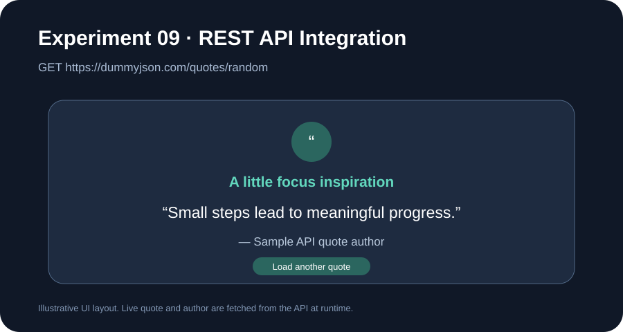
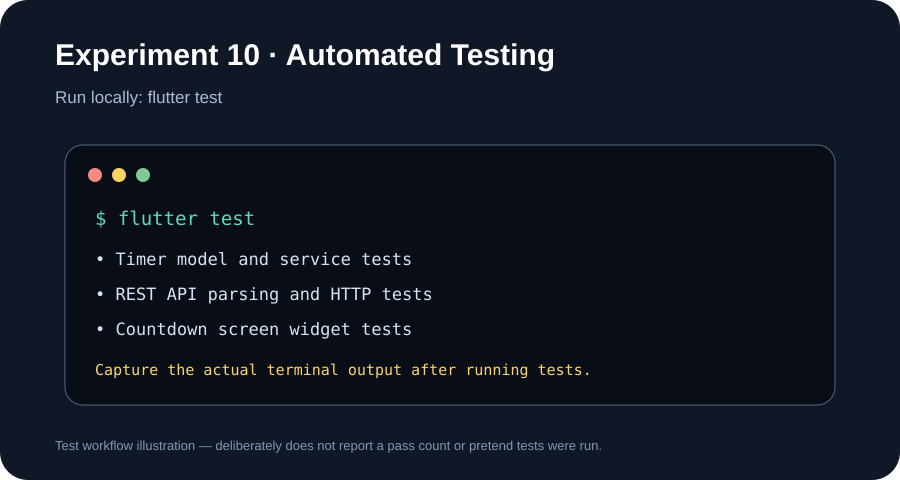

# Modern Countdown Timer Application ⏱️

[](https://flutter.dev)
[](https://dart.dev)
[](https://m3.material.io)
[](https://docs.flutter.dev/testing)

A Flutter-based countdown timer designed to help users manage study sessions, breaks, workouts, and daily tasks. The application includes timer presets, custom durations, pause/resume controls, session history, theme settings, and completion alerts.

---

## 🎓 Academic Project Information

- **Institution:** ACE Engineering College
- **Department:** Computer Science & Engineering
- **Program:** Bachelor of Technology (B.Tech), 3rd Year, Semester 1
- **Course / Lab:** Mobile Application Development Lab (Flutter 2026 Curriculum)
- **Student Name:** Sriyansh
- **Roll Number:** `24AG1A05585`
- **Academic Year:** 2026

---

## 🎯 Project Objectives

- Build a functional countdown timer using Flutter and Dart.
- Design a responsive interface using Flutter widgets.
- Manage timer state and update the interface dynamically.
- Allow users to select preset durations or enter a custom duration.
- Store timer preferences and session data locally.
- Apply navigation, form validation, reusable widgets, themes, and testing concepts.

## 🌟 Main Features

1. **Countdown timer:** Start, pause, resume, reset, and adjust the remaining time.
2. **Quick presets:** Choose from predefined durations for short breaks, study sessions, workouts, and focused work.
3. **Custom duration:** Enter a session name and duration through a validated form; save reusable presets.
4. **Session history:** View completed timer sessions and clear the history.
5. **Theme settings:** Switch between light, dark, and system themes.
6. **Completion feedback:** Audio and vibration feedback when a timer finishes.
7. **Persistent data:** Save timer state, custom presets, preferences, and session history locally.
8. **Responsive interface:** Adapt the layout to available screen dimensions.
9. **Fade and slide entrance:** Animate the timer panel when the dashboard opens.
10. **REST API quote:** Fetch a random focus quote using HTTP GET and display parsed JSON data.

---

## 🧪 Experiments Based on the Flutter Lab Manual

The sections below follow the experiment sequence and titles in the **UI Design – Flutter Lab Manual (2026)**. Each section explains how the topic relates to this Countdown Timer project. An experiment is marked as not demonstrated when the current project does not contain the required implementation.

### Experiment 1 — Installation of Flutter & Dart SDK and Introduction to Dart Programming

**Aim:** Set up the Flutter and Dart development environment and understand the basics of Dart programming.

**Application in this project:**
- The application is developed using Flutter and Dart.
- The project uses a standard Flutter project structure.
- Dependencies are managed through `pubspec.yaml`.

**Setup commands:**
```bash
flutter doctor
flutter pub get
flutter run
```

*No separate setup screenshot is currently included in the repository.*

### Experiment 2 — Exploring Flutter Widgets and Implementing Different Layout Structures Using Row, Column, and Stack

**Aim:** Understand Flutter widgets and create layouts using common UI components.

**Application in this project:**
- Uses Material widgets to build the timer interface.
- Uses layout widgets to arrange timer information, controls, and preset options.
- Uses reusable UI elements for consistent presentation.



<sub>Illustrative UI preview stored in the repository; it is not a device screenshot.</sub>

### Experiment 3 — Design a Responsive User Interface Using MediaQuery and LayoutBuilder

**Aim:** Create interfaces that adapt to different screen sizes and orientations.

**Application in this project:**
- The timer dashboard is designed to adapt to the available screen width.
- Layout constraints are used to keep controls and timer information arranged clearly.


<sub>The repository currently contains a source-based UI preview, not separate phone and tablet captures.</sub>

### Experiment 4 — Navigation Between Different Screens Using Navigator and Named Routes

**Aim:** Navigate between multiple screens and understand route management.

**Application in this project:**
- The application separates the timer dashboard, settings, and session history into screens.
- Users can open the session history screen and return to the main timer interface.



<sub>Illustrative UI preview; session entries shown are sample content.</sub>

### Experiment 5 — Understanding Stateful and Stateless Widgets and Implementing State Management Using setState() and Provider

**Aim:** Understand widget state and update the UI when application data changes.

**Application in this project:**
- Provider and ChangeNotifier are used for shared timer state.
- Timer actions update the displayed remaining duration and control state.
- The interface reflects changes such as start, pause, resume, and reset.


<sub>Illustrative UI preview; the project source contains the timer state-management implementation.</sub>

### Experiment 6 — Creating Custom Widgets and Applying Themes and Custom Styles in Flutter

**Aim:** Create reusable widgets and maintain consistent application styling.

**Application in this project:**
- The application uses reusable UI components for timer controls and preset presentation.
- Theme configuration is maintained separately.
- Light, dark, and system theme options are provided.


<sub>Illustrative UI preview, not a device capture.</sub>

### Experiment 7 — Designing Forms with Various Input Fields and Implementing Form Validation and Error Handling

**Aim:** Collect user input and validate it before accepting the form.

**Application in this project:**
- The custom duration dialog accepts a session name and time values.
- Duration input is validated before a custom timer can be configured.
- Users can save custom durations as reusable presets.



<sub>Illustrative UI preview, not a device capture.</sub>

### Experiment 8 — Implementing UI Animations Using Flutter Animation Framework and Experimenting with Fade and Slide Animations

**Aim:** Understand Flutter animations and use them to improve the user interface.

**Implementation in this project:**
- Added a reusable `FadeSlideEntrance` widget using `TweenAnimationBuilder`.
- The timer panel fades from opacity 0 to 1 and slides upward by 18 logical pixels.
- The entrance uses an ease-out curve and a 650 ms duration.
- The animation wraps only the timer panel; timer state, controls, presets, settings, history, and form validation are unchanged.



<sub>Implementation illustration, not a captured device screenshot or animation recording. Capture the running timer panel to provide practical evidence.</sub>

### Experiment 9 — Fetching Data from a REST API and Displaying the Data in Flutter UI

**Aim:** Fetch data from a REST API, parse JSON, and display the result in the application.

**Implementation in this project:**
- Added the `http` package and a `FocusQuoteService` that sends an HTTP GET request to `https://dummyjson.com/quotes/random`.
- Parses the JSON response into a `FocusQuote` model.
- Added a separate **REST API – Focus Quote** screen, opened using the quote icon in the home screen app bar.
- Shows a loading indicator, the returned quote and author, an error state, and a retry button.
- The API feature is isolated in its own service and screen; it does not change the existing timer workflow.



<sub>Illustrative screen preview. The quote and author shown in the running application are retrieved from the live API.</sub>

### Experiment 10 — Writing Unit Tests for Flutter UI Components and Using Flutter Debugging Tools to Identify and Fix Issues

**Aim:** Test application logic and UI components and use Flutter tools to identify issues.

**Implementation in this project:**
- Retains the existing timer model, timer service, and widget test suites.
- Adds unit tests for quote JSON parsing, successful HTTP GET responses, non-200 responses, and unexpected JSON fields.
- Uses Flutter's test framework and a mocked HTTP client so API tests do not depend on an internet connection.

**Run the complete test suite:**
```bash
flutter pub get
flutter test
```



<sub>Testing workflow illustration only. It does not show an executed terminal result or claim a passing test count. Run `flutter test` locally and capture the real terminal output for submission evidence.</sub>

---

## 🏗️ Project Structure

```text
countdown_timer/
├── assets/
│   └── sounds/              # Timer alert sound
├── lib/
│   ├── models/               # Timer preset and history models
│   ├── screens/              # Home, settings, history, and dialog screens
│   ├── services/             # Timer, storage, and audio services
│   ├── theme/                # Application theme configuration
│   ├── widgets/              # Reusable UI components
│   └── main.dart             # Application entry point
├── screenshots/              # Experiment UI and workflow illustrations
├── test/
│   ├── unit/                 # Unit tests
│   └── widget_test.dart      # Widget tests
├── pubspec.yaml              # Dependencies and assets
└── README.md
```

## 🛠️ Technologies Used

- **Flutter** — cross-platform UI framework
- **Dart** — application programming language
- **Provider** — state management
- **SharedPreferences** — local data persistence
- **audioplayers** — timer completion sound
- **http** — REST API requests
- **flutter_test** — unit and widget testing

## 🚀 Getting Started

### Prerequisites

- Flutter SDK
- Dart SDK
- Android Studio or Visual Studio Code
- Android emulator or a physical device

### Run the project

1. Clone the repository:
   ```bash
   git clone https://github.com/sriyansh-0001/countdown_timer.git
   ```
2. Open the project directory:
   ```bash
   cd countdown_timer
   ```
3. Install dependencies:
   ```bash
   flutter pub get
   ```
4. Run the application:
   ```bash
   flutter run
   ```
5. Run tests:
   ```bash
   flutter test
   ```

## 🧪 Test Coverage

The test suite includes:
- **Model tests:** preset and history serialization and formatting.
- **Timer service tests:** timer state, preset selection, pause/resume, reset, time extension, and custom preset operations.
- **REST API tests:** quote JSON parsing, successful HTTP GET response, non-200 response handling, and invalid response fields.
- **Widget tests:** home screen rendering, timer controls, preset selection, and academic information display.

Execute `flutter test` to see the actual test results in your environment. No unverified pass count is published here.

## 📄 Project Report

The repository also contains the academic project report:

[ACE Engineering College Project Report](./ACE_ENGINEERING_COLLEGE_PROJECT_REPORT.md)

---

## 📸 Screenshot Notes

The SVG files in `screenshots/` are labelled implementation or workflow illustrations, not genuine device captures. For final lab evidence, replace or supplement them with screenshots captured from the running app (Experiment 8 and 9) and the actual terminal output from `flutter test` (Experiment 10).

---

*Developed by Sriyansh (Roll No: 24AG1A05585), ACE Engineering College, 2026.*
